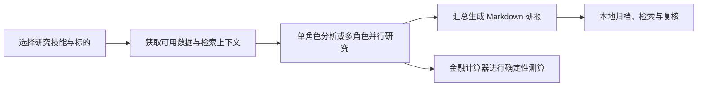

# 🦅 FinMaster — 价值投资大师工作站

> **把价值投资研究方法，变成一套可执行、可追溯、可复用的 AI 工作流。**

FinMaster 面向希望把研究做得更系统的投资者与分析者。从行业筛选、公司研究到估值和投后跟踪，你可以在一个桌面工作台中调用结构化研究技能、接入金融数据、并行组织多角色分析，并将结果整理为可检索的 Markdown 研报。

FinMaster 的研究体系借鉴了 [AI-Berkshire](https://github.com/xbtlin/ai-berkshire) 的投资技能与提示词设计，尤其是围绕巴菲特、芒格、段永平和李录四位价值投资大师的分析视角。FinMaster 结合自身的产品设计，将这些研究思路融入 Streamlit 工作台、多角色执行调度、金融数据接入、本地研报知识库和确定性计算工具。

[](LICENSE)
[](https://www.python.org/)
[](https://streamlit.io/)

> 本项目用于研究辅助和学习，不构成投资建议。AI 输出可能包含错误或遗漏；请自行核对数据来源、日期和原始披露，不要将其作为自动交易或投资决策的唯一依据。

## 为什么使用 FinMaster

- **从研究框架开始，而不是从空白提示词开始**：21 项技能覆盖行业筛选、个股深研、估值、投后跟踪与内容整理，帮助把重复研究流程结构化。
- **用多个视角拆解复杂问题**：核心投研技能可并行组织商业模式、财务估值、竞争格局和风险治理等分析，再汇总为一份报告。
- **研究依据更容易复核**：整合 Yahoo Finance、SEC EDGAR、FRED 等来源，并支持可选数据插件和联网搜索；报告会尽可能注明数据来源。
- **分析结果可以沉淀复用**：生成的 Markdown 研报归档在本地，支持全文检索、筛选、阅读和下载。
- **把确定性计算与模型判断分开**：计算器使用 `Decimal` 处理确定性公式；AI 生成的观点和数字仍应独立核验。

## 功能一览

- **研究工作台**：提供 21 项研究技能，覆盖行业筛选、公司研究、估值、投后跟踪和内容整理；部分技能使用多角色并行分析。
- **数据接入**：按配置调用 Yahoo Finance（通过 yfinance）、SEC EDGAR、FRED，以及可选的 Finnhub、FMP、Adanos、Tiingo 和联网搜索服务。
- **历史研报**：将生成的 Markdown 报告保存在本地 `reports/`，支持筛选、全文检索、阅读和下载。
- **金融计算器**：确定性计算逻辑使用 Python `Decimal`；这不代表模型生成的所有数值都经过了程序校验。
- **系统设置**：在本地界面配置模型和数据服务。设置页会将配置保存到项目目录的 `.env` 文件。

## 研究流程



多角色分析和数据覆盖会因技能、标的、API Key 与上游服务可用性而异；数据接入不代表所有字段都一定有值。

### 数据与服务说明

| 来源 | 用途 | 注意事项 |
| --- | --- | --- |
| Yahoo Finance / yfinance | 行情和财务字段 | 第三方聚合数据，可能延迟、缺失或修订，不是交易所直连报价。 |
| SEC EDGAR | 美股公司披露信息及原文链接 | 覆盖范围主要是 SEC 登记公司；接口可用性受 SEC 服务及网络影响。 |
| FRED | 美国宏观经济序列 | 观测频率和发布日期依指标而异，不等同于实时行情。 |
| Finnhub、FMP、Adanos、Tiingo | 可选的扩展数据 | 需自行申请并配置相应 API Key；具体权限、价格和额度以服务提供方为准。 |
| Tavily、Gemini Search、DuckDuckGo | 可选联网检索 | 可在设置中选择搜索提供器；第三方搜索服务可能有配额、地区或网络限制。 |

应用会尽可能标示数据来源，但不同接口返回的字段和时间信息并不一致。使用前应查看报告中的来源说明，并回到原始披露或供应方页面核验重要数据。

## 快速开始

### 环境要求

- Python 3.11 或更高版本
- 可访问所选模型和数据服务的网络
- 生成 AI 研究内容需要 Gemini API Key；其他数据源密钥按需配置

### 安装

```bash
git clone https://github.com/johhhhnny/finmaster.git
cd finmaster

python3.11 -m venv .venv
source .venv/bin/activate
python -m pip install --upgrade pip
python -m pip install -r requirements.txt
```

Windows PowerShell 创建并激活虚拟环境：

```powershell
py -3.11 -m venv .venv
.\.venv\Scripts\Activate.ps1
python -m pip install --upgrade pip
python -m pip install -r requirements.txt
```

若要在 Linux/Python 3.11 环境中复现 CI 的锁定依赖，使用：

```bash
python -m pip install -r requirements-lock.txt
```

### 配置

复制模板并编辑 `.env`：

```bash
cp .env.example .env
```

至少配置 `GEMINI_API_KEY` 才能使用模型生成研究内容。Yahoo Finance 不需要单独配置 Key；SEC 联系邮箱、FRED Key、搜索 Key 和其他数据插件均可按需设置。`.env.example` 将 `SEARCH_PROVIDER` 设为 `none`，即关闭联网搜索；若不创建 `.env`，程序的默认值为 `auto`。

也可以启动应用后通过「系统与数据源设置」页面填写配置。设置会以明文写入本地 `.env`：不要提交该文件、把它放入共享目录或粘贴到公开位置。`.env` 已加入 `.gitignore`。

### 启动

```bash
streamlit run app.py --server.address 127.0.0.1 --server.port 8501
```

然后打开 <http://127.0.0.1:8501>。也可以运行 `python start.py` 启动。

默认绑定 `127.0.0.1`，仅供本机访问。应用没有内置用户认证，不要直接暴露到公网或不可信网络。

## Docker

项目提供 Dockerfile。镜像构建会排除 `.env`、虚拟环境和 `reports/`，因此研报目录需要在容器外保存并挂载：

```bash
docker build -t finmaster .
docker run --rm \
  -p 127.0.0.1:8501:8501 \
  --env-file .env \
  -v "$PWD/reports:/app/reports" \
  finmaster
```

在 Windows 上请按 Docker Desktop 的路径格式调整卷挂载参数。设置页面写入的是容器内 `.env`，容器重建后不会自动保留；部署时应通过受控的环境变量或密钥管理功能注入凭据。项目没有内置认证，以上端口映射只绑定本机。不要将容器直接公开到互联网。

Docker 构建和健康端点检查已配置在 GitHub Actions 中；这不等同于生产环境压力测试或高可用部署方案。

## 开发与测试

安装依赖后，在仓库根目录运行：

```bash
python -m unittest discover -s tests -v
python -m compileall -q app.py engine ui tools tests
```

GitHub Actions 会在 Push 和 Pull Request 时安装锁定依赖、运行测试并构建 Docker 镜像，随后检查 Streamlit 健康端点。

## 项目结构

```text
finmaster/
├── app.py
├── start.py
├── requirements.txt
├── requirements-lock.txt
├── Dockerfile
├── .github/workflows/ci.yml
├── engine/
│   ├── data_sources/       # 金融数据源及 DataHub 调度
│   ├── archive_manager.py  # 本地研报索引和搜索
│   ├── executor.py        # 技能执行及多角色调度
│   ├── llm.py              # Gemini 客户端
│   └── skill_manager.py    # 技能注册和 Prompt 装配
├── ui/                     # Streamlit 页面和样式
├── skills/                 # 21 项研究技能定义
├── tools/                  # 金融计算和报告审计逻辑
├── tests/
└── reports/                # 本地 Markdown 研报
```

## 许可与致谢

本项目采用 [MIT License](LICENSE)。感谢 [AI-Berkshire](https://github.com/xbtlin/ai-berkshire) 项目及其作者：FinMaster 借鉴了其投资技能与提示词设计，尤其是对巴菲特、芒格、段永平和李录四位价值投资大师的研究框架。许可证文件保留了相关版权声明。
