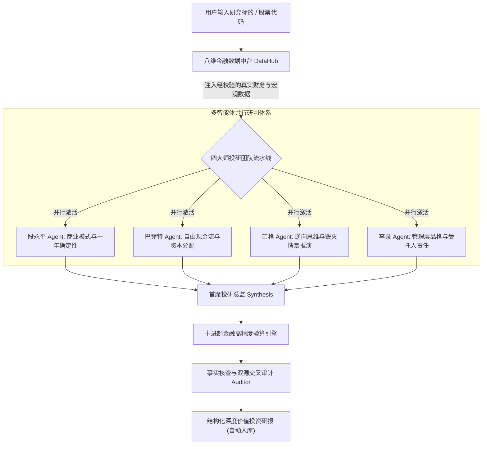

# 🦅 FinMaster — 价值投资大师工作站

> **专为价值投资者打造的开源多智能体认知投研系统**  
> 融合巴菲特、芒格、段永平和李录四位价值投资大师的认知框架、八维金融数据中台与纯十进制严谨估值算法，让每位投资者拥有独立且深度的大师级智囊团。

[](LICENSE)
[](https://www.python.org/)
[](https://streamlit.io/)
[](https://ai.google.dev/)
[](tools/financial_rigor.py)

---

## 📖 项目简介

**FinMaster（价值投资大师工作站）** 是一款面向个人专业投资者、分析师与资产配置机构的**自主化、全流程多智能体投研系统**。

在传统的投研与投资决策中，投资者往往面临多重挑战：
- **认知片面**：容易陷入单一思维定势与“证实偏见”，缺乏高质量的反方辩论；
- **数据繁冗**：真实财务数据分散于各官方监管平台与商业终端，清洗与交叉校验耗时费力；
- **通用大模型幻觉**：通用 AI 聊天机器人缺乏财务常识，不仅频繁虚构最新财务数字，更存在浮点数计算漂移与模棱两可的两面讨好言论；
- **缺乏系统闭环**：碎片化的投研无法贯穿“赛道初筛 ➔ 深度研判 ➔ 严苛估值 ➔ 投后跟踪”的完整投资生命周期。

**FinMaster 为解决上述痛点而生**。它不是一个简单的聊天机器人插件，而是一套将**严苛价值投资哲学工程化、代码化**的现代投研系统。通过集成**四位投资大师多智能体协同研讨流水线**、**八维主权与权威金融数据中台**、**21 项覆盖全流程的投资技能**与**纯十进制金融高精度验算引擎**，FinMaster 协助您穿透市场噪音，回归投资的商业本质。

---

## ⚡ 为什么选择 FinMaster？

| 对比维度 | 通用大模型（如 ChatGPT / Claude 对话） | 传统手工研报撰写 | FinMaster 价值投资工作站 |
| :--- | :--- | :--- | :--- |
| **决策思维** | 单一角色平庸综述，态度模糊，两面讨好 | 容易受到个人情绪、市场狂热与认知盲区干扰 | **四大师协同辩论**：段永平常识、巴菲特造血、芒格逆向清算、李录管理层品格，各抒己见并强制产出明确买卖结论 |
| **数据保真度** | 频繁捏造虚假财报指标与过时股价（严重幻觉） | 需往返切换 SEC、彭博、Wind 等多个终端手动搬运 | **八维数据中台驱动**：官方 SEC 10-K/10-Q、FRED 宏观、yfinance 财务三表自动交叉验证注入，拒绝数据污染 |
| **估值数学精度** | 大模型常识性心算漂移，浮点数运算错误频发 | Excel 手工建模繁琐，折现率与终值倍数易被篡改 | **纯十进制严格金融运算**：扣现金 PE、自由现金流收益率、安全边际分层与未来 5 年三情景 CAGR 精密推演 |
| **方法论体系** | 依赖临时的手工 Prompt，输出结构与质量极不稳定 | 研报散落本地文件夹，缺乏体系化技能沉淀 | **21 项专业投资技能库**：涵盖赛道漏斗、深度个股、买入 Checklist、投后漂移监控至一键微信发布全流程 |
| **操作体验** | 纯文本对话框，无法可视化展示多智能体并发状态 | 流程碎片化，效率低下 | **专业金融终端级 Web 界面**：自适应宽屏排版、多大师并行流式卡片、知识库全文检索与内置可视化计算器 |

---

## 🌟 四大核心支柱

### 1. 👥 四大师多智能体协同研判流水线
在核心研究场景中，FinMaster 并行激活四位投资大师的认知模型，各司其职，互不妥协：
- 🔴 **段永平（商业常识与本分视角）**：审视商业模式的极简常识、不做什么原则、「买股票就是买公司」的十年确定性；
- 🔵 **沃伦·巴菲特（自由现金流与护城河视角）**：聚焦真实的自由现金流造血能力、历史资本配置纪录与安全边际厚度；
- 🟣 **查理·芒格（逆向思维与毁灭性情景视角）**：反过来想，全面推演技术颠覆、行业内卷、致命杠杆与商业模式可能走向消亡的情境；
- 🟢 **李录（现代文明演进与管理层受托人视角）**：审视文明周期与长期大势，严格核查管理层的品格、受托人责任与薪酬激励对齐度；
- ⚖️ **首席投研总监（Team Lead Synthesis）**：综合四大视角的观点张力，消除模棱两可的说辞，分层输出针对保守型、稳健型与进取型投资者的结构化决策研报。



### 2. 🌐 八维主权与商业金融数据中台 (DataHub)
为杜绝大模型在金融数字上的幻觉，FinMaster 构建了统一的金融数据中台，直接连接权威官方源与专业商业数据源：
1. **美国 SEC EDGAR**：自动调取官方 10-K / 10-Q 真实年报与季报披露；
2. **FRED（美联储经济数据中心）**：实时获取无风险基准利率、CPI、通胀预期与宏观信贷指标；
3. **yfinance 核心财务三表**：自动化抓取利润表、资产负债表与现金流量表历史序列；
4. **Finnhub**：对接华尔街分析师一致预期、目标价分歧度与财报日历；
5. **FMP（Financial Modeling Prep）**：提取投入资本回报率 (ROIC)、加权平均资本成本 (WACC) 与杜邦分析拆解；
6. **Tiingo**：高保真复权股价、波动率与高频市场交易序列；
7. **Adanos 另类情绪指数**：监测社交与媒体另类情绪指标，防范极端市场过热；
8. **多级弹性联网检索**：内置 Tavily AI、Google Search 原生检索与 DuckDuckGo 智能降级，确保持续可用。

### 3. 🎯 21 项专业价值投资全生命周期技能树
FinMaster 将专业价值投资的完整工作流抽象为 5 大阶段、21 项即开即用的专业技能：

| 阶段 | 技能名称 | 核心研究目的与交付成果 |
| :--- | :--- | :--- |
| **阶段一：初筛与赛道漏斗** | 行业漏斗筛选 | 穿透行业周期，识别具有长期结构性增长潜力的优质赛道 |
| | 去劣筛选法则 | 基于 7 条硬性负面指标快速剔除伪成长、高负债与治理硬伤企业 |
| | 供应链瓶颈猎手 | 寻找产业链中具备独家卡位与不可替代定价权的隐形冠军 |
| | 时代α捕手 | 捕捉符合未来十年生产力爆发与文明演进红利的超级标的 |
| **阶段二：深度个股研究** | **四大师投研团队（旗舰）** | **巴菲特、段永平、芒格、李录四视角并行辩论与总监综合决策** |
| | 深度公司系列研究 | 全景式商业模式解构、竞争壁垒分析与单位经济模型测算 |
| | 财报精读团队 | 深度拆解三张财务报表，识别会计调节粉饰与潜在财务地雷 |
| | 管理层纵深研究 | 穿透管理层历史行事纪录、薪酬结构、资本配置偏好与诚信度 |
| | 未上市公司商业评估 | 针对未上市/初创标的的商业模式前瞻性定性分析与沙盘推演 |
| **阶段三：估值与投资准则** | 巴菲特买入前 Checklist | 10 项不可妥协的买入硬性准则逐条严格对照审查 |
| | 收息投资评估 | 针对高股息红利标的的可持续分红造血能力与股息安全垫测算 |
| | 段永平思维问答 | 换位段永平认知视角，以极简商业常识直击企业终局价值 |
| **阶段四：投后跟踪与风控** | 投资论文（Thesis）跟踪 | 建立投资初衷基线，定期比对财报关键假设与业务进展 |
| | 投资论文漂移检测 | 敏锐捕捉逻辑生变、竞争格局恶化或管理层战略偏离信号 |
| | 公司突发新闻脉搏 | 针对单日暴跌或舆情异动进行事件驱动归因与商业实质评估 |
| | 投资组合体检与风控 | 盘点持仓集中度、行业相关性与极端流动性压力测试 |
| **阶段五：成果转化与发布** | 微信公众号深度长文排版 | 自动化将严谨研报提炼转写为图文并茂、逻辑通俗的高阅读量公众号文章 |

### 4. 🧮 零浮点误差的十进制金融严谨性引擎
价值投资不仅是哲学，更是严肃的数学纪律。FinMaster 内置了基于纯 `Decimal` 高精度算法的金融严谨性工具箱：
- **扣现金市盈率（Ex-Cash PE）校验**：精确扣除账面冗余现金与有息负债，还原真实主营业务买入倍数；
- **市值与总股本匹配审计**：以 1% 极小容差校验最新股价与总股本推算的实际隐含市值；
- **安全边际阶梯测算**：自动对比现价与内在价值下限，划分 30%/50% 阶梯式安全边际保护垫；
- **未来 5 年三情景 CAGR 推演**：针对悲观（保守）、中性（基准）、乐观三组复合增速与退出估值，精密测算投资回报率。

---

## 🖥️ 交互界面与系统体验

FinMaster 采用专为金融分析师量身打造的高效 Web 界面：

1. **智能投研主工作台（Workbench）**：
   - **自适应宽屏排版**：随屏幕宽度自适应拉伸，高信息密度展示；
   - **现代化研究参数控制台**：灵活输入股票代码或公司名称，智能路由匹配多源金融底座；
   - **实时流式多大师看板**：并行呈现四位大师的思考过程与结构化分析结果。
2. **交互式历史研报知识库（Archive）**：
   - 自动索引本地历史报告，支持标的标签即时过滤与毫秒级全文检索；
   - 内置沉浸式 Markdown 阅读器与 `.md` 研报原稿一键导出下载。
3. **十进制金融估值计算器（Calculator）**：
   - 纯十进制交互式估值看板，内置标杆企业财务模型，支持即时动态试算。

---

## 🚀 快速开始

### 方式一：本地极速运行（推荐）

#### 1. 克隆代码库并安装依赖
```bash
git clone https://github.com/your-username/finmaster.git
cd finmaster

# 创建虚拟环境（可选但推荐）
python -m venv .venv
source .venv/bin/activate  # Windows 用户: .venv\Scripts\activate

# 安装核心依赖
pip install -r requirements.txt
```

#### 2. 系统环境配置（分级赋能体系）

FinMaster 采用**“基础核心引擎 + 进阶八维数据中台”**的分级配置架构，您可以根据投研深度与业务需求自由组合：

##### 🟢 基础核心配置（开箱即用）
仅需配置核心大模型，即可完整驱动四位投资大师多智能体协同流水线与全套 21 项投资技能：
- **`GEMINI_API_KEY`**：驱动大师团队深度推理的核心认知大脑（推荐 `gemini-3.5-flash-lite` 或 `gemini-2.5-flash`，前往 [Google AI Studio](https://aistudio.google.com/) 免费创建）；
- **`SEC_CONTACT_EMAIL`**：符合美国 SEC EDGAR 官方披露规范的 User-Agent 联络邮箱（如 `user@example.com`，免 Key，必填声明以直通抓取官方 10-K/10-Q 真实年报底稿）；
- **`yfinance` 财务三表**：系统原生内置免密直连通道，自动获取历史利润表、资产负债表与现金流量表。

##### 🚀 进阶专业数据中台配置（推荐 · 释放 100% 机构级投研算力）
若需引入主权级无风险利率、华尔街投行一致预期、ROIC 杜邦拆解与散户预测情绪，建议在系统内按需配置以下专业插件（**全部提供免费开发者额度**）：

| 数据维度 | 环境变量项 | 核心投研赋能 | 免费获取渠道与额度 |
| :--- | :--- | :--- | :--- |
| **宏观主权利率** | `FRED_API_KEY` | 美联储国债真实收益率、主权无风险贴现率、CPI 通胀预期 | [FRED 官网](https://fred.stlouisfed.org/) 免费申请，高并发直连 |
| **机构一致预期** | `FINNHUB_API_KEY` | 华尔街投行一致目标价、盈利 Surprise（超预期度）与业绩日历 | [Finnhub](https://finnhub.io/) 免费注册，60 次/分钟 |
| **资本回报与估值** | `FMP_API_KEY` | 投入资本回报率 (ROIC)、加权平均资本成本 (WACC) 与杜邦拆解 | [Financial Modeling Prep](https://financialmodelingprep.com/) 免费版 250 次/天 |
| **量化全复权时序** | `TIINGO_API_KEY` | 30 年量化高精度全复权历史价格序列、长周期波动率推演 | [Tiingo](https://www.tiingo.com/) 免费版 1,000 次/天 |
| **另类情绪与盘口** | `ADANOS_API_KEY` | 散户社交情绪热度 (Buzz Score) 与 Polymarket 预测盘口数据 | [Adanos](https://adanos.org/) 免费注册 |
| **深度研究级检索** | `TAVILY_API_KEY` | 专为 AI 投研优化的深度联网检索，过滤金融高信噪比实时研报 | [Tavily AI](https://tavily.com/) 每月 1,000 次免费调用 |

##### ⚙️ 配置方式（任选其一）
- **方式 A（图形化界面 · 强烈推荐）**：启动 Web 工作台后，直接在左侧边栏底部的「⚙️ 系统与数据源设置」中集中填写，内置各接口连通性一键测试，并安全持久化至本地 `.env`；
- **方式 B（环境文件）**：
  ```bash
  cp .env.example .env
  # 编辑 .env 文件填入对应密钥即可
  ```

#### 3. 启动投研工作台
```bash
python start.py
# 或直接运行: streamlit run app.py
```
启动成功后，浏览器将自动开启 `http://localhost:8501`。

---

### 方式二：Docker 容器化部署（试验性 · 未经完整测试）

> ⚠️ **提示**：本项目目前主要在本地原生环境（Mac / Linux / Windows + Python 3.9+）进行了深度测试与验证。代码库内已提供标准 `Dockerfile`，但容器化运行流程尚未经过全链路完整压力测试，当前作为试验性特性提供，欢迎社区开发者测试并提交 PR 改进。

```bash
# 构建镜像
docker build -t finmaster .

# 启动容器（推荐直接挂载 .env 注入多源配置）
docker run -d \
  -p 8501:8501 \
  --env-file .env \
  --name finmaster-workbench \
  finmaster
```
访问 `http://localhost:8501` 即可体验。

---

## 📁 模块架构全景

```text
finmaster/
├── app.py                  # 极简 Web 主路由与控制器
├── start.py                # 快速启动自检脚本
├── requirements.txt        # 依赖清单 (Streamlit, Google GenAI SDK 等)
├── Dockerfile              # 容器化独立部署镜像文件
├── ui/                     # 现代化 Web 视图层 (模块化解耦)
│   ├── styles.py           # 金融终端级 CSS 样式规范与自适应响应式设计
│   ├── sidebar.py          # 侧边栏导航、21 项技能精选微胶囊与常驻底部设置
│   ├── workbench.py        # 投研主工作台（标的卡片、多大师并行流式看板）
│   ├── archive.py          # 历史研报知识库（全文检索、标的 Chips 筛选、阅览与下载）
│   └── calculator.py       # 十进制金融严谨性计算器（扣现金 PE、三情景 CAGR 测算）
├── engine/                 # 核心执行与调度引擎
│   ├── llm.py              # LLM 通信层 (流式传输、防 429 退避重试与搜索弹性降级)
│   ├── executor.py         # 单智能体与多智能体并行流水线调度中心
│   ├── skill_manager.py    # 21 项专业投资技能注册与动态装配引擎
│   ├── archive_manager.py  # 研报资产扫描、倒排索引与全文检索
│   └── config.py           # 环境变量与用户设置持久化管理
├── datahub/                # 八维主权与商业金融数据中台
├── skills/                 # 21 项专业价值投资 Prompt 资产 (.md)
├── tools/                  # 确定性高精度金融工具
│   ├── financial_rigor.py  # 纯十进制 Decimal 估值模型与股本容差校验
│   └── report_audit.py     # 双源交叉数据审计与事实核查
└── reports/                # 本地研报持久化知识库
```

---

## 🛡️ 投资纪律与质量准则

FinMaster 在架构层面严格践行价值投资的严苛底线：
1. **防本地历史数据污染（Anti-Contamination）**：严禁利用本地历史过时数据揣测当前行情。最新现价、总市值与财务数据必须通过实时数据中台或官方监管披露重新验真。
2. **拒绝浮点误差与心算漂移（Absolute Decimal Rigor）**：杜绝使用浮点数估算企业估值乘数与折现率，所有关键财务推演均依托严谨的十进制数学算法。
3. **强制给出明确结论（No Waffling）**：拒绝模棱两可的两面讨好式研报，必须依据安全边际测算，分层给出明确的买卖态度与潜在风险底线。

---

## 🤝 致谢与声明

- **方法论致谢**：感谢开源项目 [AI Berkshire](https://github.com/xbtlin/ai-berkshire)（@xbtlin）在价值投资提示词工程及大师角色提炼上的开创性工作。FinMaster 在其基础上完成了全套现代化 Web 架构、八维金融数据中台、高精度计算引擎与多智能体流水线的独立演进与产品化重构。
- **免责声明**：本项目仅供技术研究、投资哲学学习与个人辅助分析使用，不构成任何形式的投资建议、投资要约或买卖推荐。金融市场存在风险，投资需独立思考、审慎决策。

---

*FinMaster — 价值投资大师工作站，让深度与常识回归每一次投资决策。*
